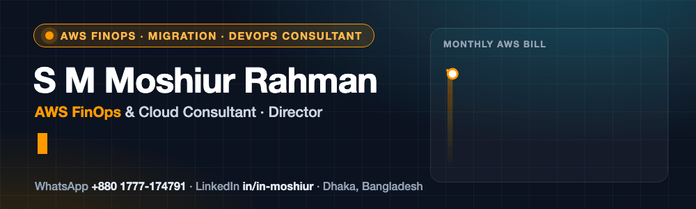

<h3>🟢 OPEN TO WORK · AVAILABLE FOR HIRE · AWS CONSULTING</h3>

---

## 👋 About me

I'm an **AWS Certified Solutions Architect and cloud consultant in Dhaka, Bangladesh**, and the founder of [TICON SYSTEM LIMITED](https://www.ticonsys.com/). I help startups and businesses **cut their AWS bill, migrate to AWS safely, and ship through automated DevOps pipelines**.

> **Hiring an AWS consultant?** Send me a WhatsApp message with what you run on AWS and roughly what you spend per month: **[+880 1777-174791](<https://wa.me/8801777174791?text=Hi%20Moshiur%2C%20I%27d%20like%20to%20hire%20you%20for%20an%20AWS%20project.>)**

## 🛠️ Services

| | Service | What you get |
| :-: | --- | --- |
| 💰 | **AWS Cost Optimization (FinOps)** | A line-by-line review of your AWS bill: idle and oversized resources, Savings Plans and Reserved Instance coverage, storage tiering, NAT and data-transfer costs, plus budgets, tagging and anomaly alerts so costs stay down. |
| 🚚 | **AWS Migration** | Assessment, target architecture, and a cutover plan with rollback for moving from on-prem, VPS, Heroku, GCP or another cloud to AWS (rehost, replatform or refactor). |
| ⚙️ | **DevOps & Infrastructure as Code** | CI/CD with GitHub Actions, infrastructure in AWS CDK, SST or Terraform, containers and serverless, logging and monitoring. |
| 🔒 | **Cloud Security & Architecture Review** | Well-Architected review: IAM least privilege, network boundaries, backups and DR, CloudFront/WAF hardening. |
| 🇧🇩 | **AWS for Bangladesh businesses** | Local context: BDT billing, EPS payment integration, Bangla/English products. |

## 🏅 Certifications

| Certification | Issuer |
| --- | --- |
| **AWS Certified Solutions Architect** | Amazon Web Services |

📎 Full, verifiable list: **[LinkedIn → Licenses & certifications](https://www.linkedin.com/in/in-moshiur/details/certifications/)**

## 📚 Free resource

**[AWS Cost Optimization & Migration Playbook](https://github.com/bemoshiur/aws-cost-optimization-playbook)** is a read-only AWS CLI checklist you can run today to find waste in your account, plus a 5-phase migration runbook.

## 🚀 Selected public work

| Project | What it is |
| --- | --- |
| **[TryAWS.now](https://github.com/bemoshiur/tryaws.now)** | Prepaid AWS cloud for Bangladesh: Lightsail servers, storage, databases and domains, paid in BDT through EPS, with a Bangla/English panel. (AWS Lambda, Route 53, SST, Next.js, PostgreSQL.) |
| **[OmniRank](https://github.com/bemoshiur/OmniRank)** | SEO/AEO/GEO auditor that runs inside your repo, maps each finding to the source file that owns it, and shows the diff that fixes it. Claude Code plugin and CLI. |
| **[TakaBooks](https://github.com/bemoshiur/TakaBooks)** | Bangladeshi bookkeeping and tax (VAT/Mushak, income tax, TDS/VDS) as a Claude Skill with a zero-dependency Python engine. |
| **[StockLot ERP](https://github.com/bemoshiur/StockLot-ERP)** | Open-source multi-user ERP for wholesale/surplus apparel: sales, dues, inventory, finance and audit. Next.js, Prisma, PostgreSQL. |
| **[Bengali DOCX & PDF generator](https://github.com/bemoshiur/Bengali-Docgen-docx-PDF-production-grade)** | Correct Bengali conjuncts, embedded fonts and page-accurate TOCs from Node.js. MIT. |

## 🧰 Tech I work with

## ❓ FAQ

**Who is S M Moshiur Rahman?**
An AWS Certified Solutions Architect and cloud consultant based in Dhaka, Bangladesh, and founder of TICON SYSTEM LIMITED. He works on AWS cost optimization, AWS migration and DevOps automation.

**How can I reduce my AWS bill?**
Start with Cost Explorer grouped by service, then check for idle and unattached resources, oversized instances, missing Savings Plans, NAT Gateway data charges, S3 storage classes and log retention. The [free playbook](https://github.com/bemoshiur/aws-cost-optimization-playbook) has the commands. If you want it done for you, [message me on WhatsApp](<https://wa.me/8801777174791?text=Hi%20Moshiur%2C%20I%27d%20like%20to%20hire%20you%20for%20an%20AWS%20project.>).

**Can you migrate my servers or application to AWS?**
Yes. A migration starts with an assessment and a target architecture, then a staged cutover with a tested rollback. It works for on-prem servers, VPS hosts, Heroku and other clouds.

**How do I hire an AWS consultant in Bangladesh?**
Message me on WhatsApp **+880 1777-174791** (fastest) or on [LinkedIn](https://www.linkedin.com/in/in-moshiur/) with a short description of your AWS setup and monthly spend.

---

### 📩 Let's work together

AWS consultant Bangladesh · AWS Solutions Architect Dhaka · AWS cost optimization · AWS FinOps · AWS migration consultant · AWS DevOps engineer · cloud consulting Bangladesh · Infrastructure as Code · CI/CD · AWS Well-Architected review · hire AWS consultant

