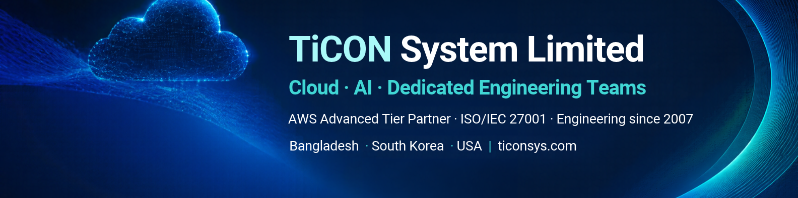

<h3>☁️ CLOUD · 🤖 AI · 👩‍💻 DEDICATED ENGINEERING TEAMS · TiCON SYSTEM LIMITED</h3>

---

## 👋 About

I'm **S M Moshiur Rahman** at **[TiCON System Limited](https://www.ticonsys.com/)**, an AWS Advanced Tier Services Partner building software since 2007 with teams in Bangladesh, South Korea and the USA.

We help startups and growing companies **ship faster**: cloud infrastructure that costs less, AI-first MVPs that are investor-ready, and dedicated engineers who join your team in days, not months. Cloud services are delivered under our cloud brand, **[TiCON Cloud](https://ticoncloud.com/)**.

> **Have a project in mind?** [Book a 30-minute call](https://cal.com/ticoncloud/aws-workload) or send a WhatsApp message to **[+880 1777-174791](https://wa.me/8801777174791)**.

## 🛠️ What TiCON System Limited does

| | Service | What you get |
| :-: | --- | --- |
| 🤖 | **AI-first MVPs & investor-ready products** | From idea to a working product your users and investors can try. AI-era developers, short build cycles, clean code you own. |
| 👩‍💻 | **Dedicated engineering teams (resource augmentation)** | 50+ qualified engineers: full-stack, AI/ML, cloud, DevOps, QA. Add one developer or a full squad, working in your tools and time zone. Pricing is custom, based on your requirements. |
| ☁️ | **Cloud & AWS (TiCON Cloud)** | Architecture, migration to AWS, DevOps and CI/CD, security reviews, and cost optimization. |
| 🔒 | **Security & compliance** | ISO/IEC 27001 practices, IAM least privilege, backups and disaster recovery, Well-Architected reviews. |

**Proven:** we have helped AWS customers optimize **$5.3M** in cloud billing over the last 3 years.

## 🚀 Selected open-source work

| Project | What it is |
| --- | --- |
| **[OmniRank](https://github.com/bemoshiur/OmniRank)** | SEO/AEO/GEO auditor that runs inside your repo, maps each finding to the source file that owns it, and shows the fix. Claude Code plugin and CLI. |
| **[TakaBooks](https://github.com/bemoshiur/TakaBooks)** | Bangladeshi bookkeeping and tax (VAT/Mushak, income tax, TDS/VDS) as a Claude Skill with a zero-dependency Python engine. |
| **[TryAWS.now](https://github.com/bemoshiur/tryaws.now)** | Prepaid AWS cloud for Bangladesh: Lightsail servers, storage, databases and domains, paid in BDT, with a Bangla/English panel. |
| **[StockLot ERP](https://github.com/bemoshiur/StockLot-ERP)** | Open-source multi-user ERP for wholesale and surplus apparel: sales, dues, inventory, finance and audit. |
| **[Bengali DOCX & PDF generator](https://github.com/bemoshiur/Bengali-Docgen-docx-PDF-production-grade)** | Correct Bengali conjuncts, embedded fonts and page-accurate TOCs from Node.js. MIT. |
| **[AWS Cost Optimization Playbook](https://github.com/bemoshiur/aws-cost-optimization-playbook)** | Read-only AWS CLI checklist to find waste in your account, plus a migration runbook. |

## 🏅 Credentials

| Credential | Issuer |
| --- | --- |
| **AWS Certified Security – Specialty** | Amazon Web Services |
| AWS Partner: Accreditation (Technical) | Amazon Web Services |
| AWS Partner: Accreditation (Business) | Amazon Web Services |
| AWS Technical Professional · AWS Business Professional | Amazon Web Services |

📎 Verify on **[LinkedIn → Licenses & certifications](https://www.linkedin.com/in/in-moshiur/details/certifications/)**

## 🧰 Tech we work with

---

### 📩 Let's build something together

TiCON System Limited · software development company Bangladesh · AI MVP development · dedicated developers · resource augmentation · AWS Advanced Tier Partner · cloud migration · DevOps · TiCON Cloud

